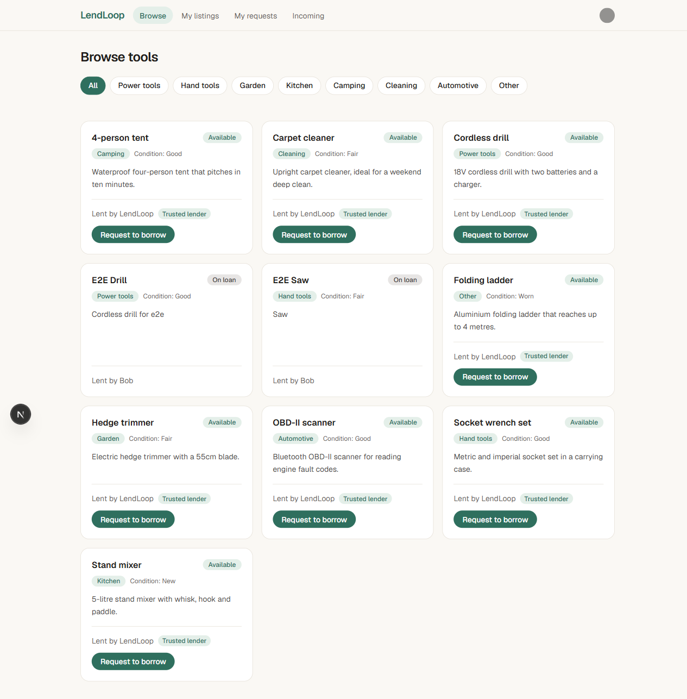
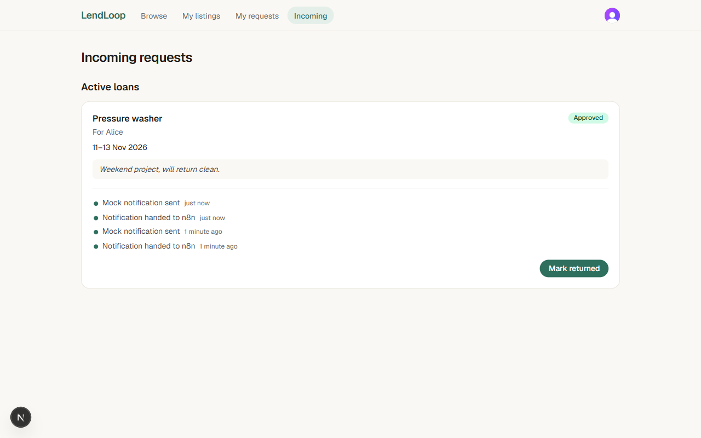
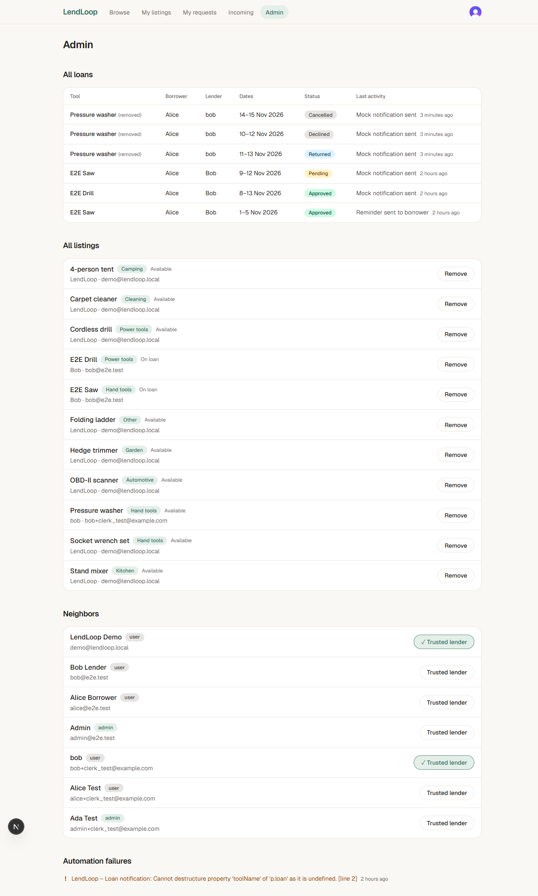

# LendLoop

**Borrow what you need. Lend what you don't.**

LendLoop is a neighborhood tool-lending board. Neighbors list tools they are willing to lend, request to borrow
them for a date range, and the lender approves, declines and marks returns. n8n does the robot work: it emails the
right person whenever a request is created or changes status, and nags borrowers daily about overdue loans. Every
automation step is written back to the loan so it shows up in the app ("Reminder sent 2 days ago").

This is a take-home for Fluence. The assignment text is in [`docs/assignment.md`](docs/assignment.md); the design
doc this README is built from is [`docs/superpowers/specs/2026-11-07-lendloop-design.md`](docs/superpowers/specs/2026-11-07-lendloop-design.md).
Where the two differ, this README describes what the code does.







## Contents

1. [Stack](#stack)
2. [Architecture](#architecture)
3. [Local setup](#local-setup)
4. [Using the app](#using-the-app)
5. [Security and data-minimization decisions](#security-and-data-minimization-decisions)
6. [Reliability and idempotency](#reliability-and-idempotency)
7. [Testing](#testing)
8. [Deployment](#deployment)
9. [Production note](#production-note)
10. [Assignment checklist](#assignment-checklist)

## Stack

| Layer | Choice |
| --- | --- |
| Frontend | Next.js 16.4 (App Router, TypeScript, Tailwind 4), React 19 |
| Auth | Clerk (`@clerk/nextjs` 7.9.25). Middleware is `src/proxy.ts`; signed-in/out UI uses `<Show when="signed-in">` |
| Data and backend | Convex 1.49 (queries, mutations, scheduled actions, HTTP actions) |
| Automation | n8n 2.46.6 (`docker.n8n.io/n8nio/n8n:2.46.6`), three workflows in `n8n/workflows/` |
| Email | Resend REST API, called from n8n with an n8n credential; offline mock mode by default |
| Tests | vitest 5 + convex-test |

Node 20+ is required.

## Architecture

```
Browser ──Clerk JWT──▶ Next.js (App Router)
   │                       │  (pages are thin; all data via Convex React hooks)
   └──────Convex client────┴──▶ Convex (queries/mutations/actions, RBAC lives here)
                                  │ outbox + scheduler              ▲ HTTP actions (signed)
                                  ▼                                 │
                        POST /webhook/lendloop-loan-event      GET /n8n/overdue-loans
                                  │                            POST /n8n/notifications
                                  ▼                            POST /n8n/reminders
                                n8n ── Resend ──▶ email        POST /n8n/automation-errors
                                  │  (error workflow on any failure) ─────────┘
```

There are no Next.js API routes. The browser talks to Convex directly with the Clerk JWT, so every authorization
decision is made in Convex functions (`convex/lib/access.ts`), not in the UI. The UI hides only what the backend
already forbids.

### Data model (`convex/schema.ts`)

| Table | Purpose |
| --- | --- |
| `users` | Mirror of the Clerk user: `clerkId`, `email`, `name`, `role` (`admin` or `user`), `trustedLender` |
| `tools` | Listings: owner, name, category, condition, description |
| `loans` | One borrow request: tool (with a `toolName` snapshot), borrower, lender, `startDate`/`endDate` (`YYYY-MM-DD`), `status` (`pending`, `approved`, `declined`, `returned`, `cancelled`), `lastReminderAt`, `reminderCount` |
| `automationEvents` | Outbox of loan events to deliver to n8n (`pending`, `delivered`, `failed`, attempts, next attempt) |
| `automationLog` | Per-loan timeline shown in the UI, and the idempotency ledger for n8n write-backs (unique by convention on `idempotencyKey`) |

Availability is derived, not stored: a tool is "on loan" iff an `approved` loan exists for it, so it cannot drift.
Removing a tool hard-deletes it; loans keep `toolName`, and pending requests on it are declined with a normal
`loan.declined` event so the borrower hears about it.

### Convex to n8n contract

Both directions use the same signing scheme:

```
x-lendloop-timestamp: <unix ms>
x-lendloop-signature: v1=<hex HMAC-SHA256(secret, `${timestamp}.${rawBody}`)>
x-lendloop-event-id:  <idempotency key>      (Convex -> n8n only)
```

The receiver recomputes the HMAC over the raw bytes, compares in constant time, and rejects timestamps more than
5 minutes from its own clock. Two secrets are used so a leak on one side cannot forge the other direction:
`CONVEX_TO_N8N_SECRET` (Convex signs, n8n verifies) and `N8N_TO_CONVEX_SECRET` (n8n signs, Convex verifies). You
may set both to the same value locally; use different values anywhere real.

| Direction | Endpoint | Purpose | Idempotency key |
| --- | --- | --- | --- |
| Convex to n8n | `POST {n8n}/webhook/lendloop-loan-event` | Deliver a loan event (`loan.requested`, `.approved`, `.declined`, `.returned`, `.cancelled`) | `eventId` (the `automationEvents` id); sent as `x-lendloop-event-id` and reused downstream, n8n itself keeps no state |
| n8n to Convex | `GET {convex-site}/n8n/overdue-loans` | Approved loans with `endDate` before today (UTC) not yet reminded today | Source-side: reminded-today loans are excluded, so a rerun returns nothing new |
| n8n to Convex | `POST /n8n/notifications` | Record that a loan-event notification was sent or failed | `notif:<eventId>` |
| n8n to Convex | `POST /n8n/reminders` | Record an overdue reminder; bumps `reminderCount`/`lastReminderAt` only on the first `sent` | `reminder:<loanId>:<YYYY-MM-DD>` |
| n8n to Convex | `POST /n8n/automation-errors` | Error workflow reports a failed execution | `n8nerr:<executionId>` |

Write-backs answer `{ "ok": true, "created": boolean }`; a replay returns `created: false` and changes nothing.
The Convex routes return `503` if `N8N_TO_CONVEX_SECRET` is not set, `401` on a bad or stale signature, and `400`
on a malformed body.

### What happens when a request is approved

1. The lender clicks Approve. The `loans.approve` mutation checks the caller is the loan's lender, the loan is
   still `pending`, and no other approved loan on that tool overlaps the dates.
2. In the same transaction it sets `status: "approved"`, inserts an `automationEvents` row (`loan.approved`,
   recipient = borrower) and schedules `internal.automation.deliverEvent`. If the mutation commits, the event
   exists and a delivery is scheduled.
3. `deliverEvent` builds a minimal payload, signs it with `CONVEX_TO_N8N_SECRET` and POSTs it to
   `N8N_LOAN_EVENT_WEBHOOK_URL`.
4. The n8n **Loan notification** workflow verifies the signature and replies `202` immediately. Convex marks the
   event `delivered` and logs `webhook_delivered`.
5. n8n builds the message and, if `LENDLOOP_EMAIL_ENABLED=true`, sends it through Resend; otherwise (or if Resend
   rejects it) it logs a mock notification.
6. n8n signs a write-back and POSTs `/n8n/notifications` with key `notif:<eventId>`. Convex records
   `notification_sent` or `notification_failed` on the loan timeline, which both neighbors see in the app.

### The three n8n workflows

| Workflow (id) | Trigger | What it does |
| --- | --- | --- |
| Loan notification (`LLLoanNotify0001`) | Webhook, raw body | Verify signature (401 and stop if bad), ack `202`, build message, Resend or mock, sign, POST `/n8n/notifications` |
| Overdue reminders (`LLOverdueRemind1`) | Daily 09:00 UTC | Sign, GET `/n8n/overdue-loans`, fan out one item per loan, Resend or mock, sign, POST `/n8n/reminders`. An empty list is a clean no-op |
| Error handler (`LLErrorHandler01`) | Error Trigger | Summarize the failed execution, sign, POST `/n8n/automation-errors`. Set as `errorWorkflow` on the other two |

More detail, including manual runs and secret rotation, is in [`n8n/README.md`](n8n/README.md).

## Local setup

Target: about 15 minutes. You need a Clerk account; Convex and Resend accounts are optional.

### Prerequisites

- Node 20+ and npm
- Docker (Docker Desktop on Windows/macOS) with Compose v2
- `openssl` (Git Bash has it) or any way to produce random hex strings
- A free [Clerk](https://clerk.com) account
- Optional: a free [Convex](https://convex.dev) account (see step 3) and a free [Resend](https://resend.com) account

### 1. Install

```bash
git clone <this repo> lendloop && cd lendloop
npm install
cp .env.example .env.local
cp n8n/.env.example n8n/.env
```

### 2. Clerk

1. Create a Clerk application (email sign-in is enough).
2. Copy the **Publishable key** and **Secret key** (API keys page) into `.env.local` as
   `NEXT_PUBLIC_CLERK_PUBLISHABLE_KEY` and `CLERK_SECRET_KEY`.
3. Let Convex trust Clerk tokens. Either enable the **Convex integration** (Clerk Dashboard, Integrations, Convex)
   or create a **JWT template** named exactly `convex` (Clerk Dashboard, JWT templates, New template, Convex
   preset). The front end requests the `convex` token and `convex/auth.config.ts` expects `applicationID: "convex"`.
   The token must carry the user's `email`. The Convex JWT-template preset does. With the native **Convex
   integration** it does not by default: open Clerk Dashboard, Sessions, **Customize session token** and add
   `{"email": "{{user.primary_email_address}}", "name": "{{user.full_name}}"}`. Without it, sign-in succeeds but
   the app shows "Your account has no email on its Clerk token".
4. Copy the **Issuer** (your Clerk Frontend API URL, for example `https://your-app-12.clerk.accounts.dev`). This is
   `CLERK_JWT_ISSUER_DOMAIN` below.

### 3. Convex (local deployment)

Generate three random values; you will need them in steps 3 and 4.

```bash
openssl rand -hex 32   # run three times: CONVEX_TO_N8N_SECRET, N8N_TO_CONVEX_SECRET, N8N_ENCRYPTION_KEY
```

Start Convex. On first run it creates the deployment and writes `NEXT_PUBLIC_CONVEX_URL` to `.env.local`.

```bash
npx convex dev
```

When prompted, choose a **local deployment** (the Convex backend runs on your machine; no tunnel needed). Without
a Convex account, run it anonymously instead:

```bash
CONVEX_AGENT_MODE=anonymous npx convex dev      # Git Bash / macOS / Linux
```

Local ports: the client API is `http://127.0.0.1:3210` (`NEXT_PUBLIC_CONVEX_URL`) and the HTTP actions
("site") are at `http://127.0.0.1:3211`. From inside the n8n container the site URL is
`http://host.docker.internal:3211`.

The first push will complain that `CLERK_JWT_ISSUER_DOMAIN` is missing, because `auth.config.ts` needs it. That is
expected: leave `convex dev` running (or restart it) and set the deployment environment in a second terminal.
`npx convex env set` works the same for local and cloud deployments.

```bash
npx convex env set CLERK_JWT_ISSUER_DOMAIN https://your-app-12.clerk.accounts.dev
npx convex env set CONVEX_TO_N8N_SECRET <hex from above>
npx convex env set N8N_TO_CONVEX_SECRET <hex from above>
npx convex env set N8N_LOAN_EVENT_WEBHOOK_URL http://localhost:5678/webhook/lendloop-loan-event
npx convex env set ADMIN_EMAILS you@example.com
npx convex env set APP_URL http://localhost:3000
```

The local Convex backend runs on your host, so it reaches n8n at `localhost:5678` (the compose file publishes the
port on `127.0.0.1`). Use your n8n's public URL here when Convex runs in the cloud.

### 4. n8n (Docker)

Edit `n8n/.env`: set `N8N_ENCRYPTION_KEY`, `CONVEX_TO_N8N_SECRET` and `N8N_TO_CONVEX_SECRET` (the **same two
values** you gave Convex). The defaults for everything else already point at the local Convex site URL and mock
mode.

```bash
npm run n8n:up
```

The workflow import works on a fresh instance without an owner account (verified on n8n 2.46.6; the Resend credential import itself has not been tested). Create the owner at <http://localhost:5678> to use the editor. Then:

```bash
npm run n8n:import
```

`n8n:import` imports the three workflows with their stable ids, creates the "Resend API" credential if
`RESEND_API_KEY` is set, publishes the three workflows (the error handler must be published or n8n refuses to run it) and restarts n8n. Stop the stack with `npm run n8n:down`.

### 5. Seed and run

Keep `convex dev` from step 3 running in terminal 1; the seed command needs the local Convex backend, which only
runs while `convex dev` is up.

```bash
npm run seed       # terminal 2: creates the "LendLoop Demo" neighbor with 8 tools; safe to re-run
npm run dev:next   # terminal 3: Next.js on :3000
```

`npm run dev` (Next.js and `convex dev` together via concurrently) is the single-terminal alternative, only when
`convex dev` is NOT already running.

Open <http://localhost:3000>. The public page lists the seeded tools. Sign up with the email you put in
`ADMIN_EMAILS` to get the admin role, then sign up a second account (another email, private window) to play the
borrower: create a request, approve it from the first account, and watch the timeline fill in.

### Environment variables

Real values are never committed: `.env*` is gitignored except the `*.example` files, and `n8n/.env` is gitignored.

**Next.js: `.env.local`**

| Variable | Required | Meaning |
| --- | --- | --- |
| `NEXT_PUBLIC_CONVEX_URL` | yes | Convex client URL. Written by `convex dev`; `http://127.0.0.1:3210` locally |
| `NEXT_PUBLIC_CLERK_PUBLISHABLE_KEY` | yes | Clerk publishable key |
| `CLERK_SECRET_KEY` | yes | Clerk secret key (server only) |

**Convex deployment env (set with `npx convex env set NAME value`; not read from `.env.local`)**

| Variable | Required | Meaning |
| --- | --- | --- |
| `CLERK_JWT_ISSUER_DOMAIN` | yes | Clerk issuer URL. Must be set before `convex dev` can push the auth config |
| `CONVEX_TO_N8N_SECRET` | yes | HMAC secret Convex uses to sign events to n8n. Must equal n8n's value |
| `N8N_TO_CONVEX_SECRET` | yes | HMAC secret Convex uses to verify n8n's write-backs. Must equal n8n's value. Unset means `/n8n/*` answers 503 |
| `N8N_LOAN_EVENT_WEBHOOK_URL` | yes | Where Convex POSTs events, ending in `/webhook/lendloop-loan-event`. Unset means events fail terminally with a visible error |
| `ADMIN_EMAILS` | for an admin | Comma-separated emails that become `admin`. Checked on every `users.ensure` |
| `APP_URL` | no | Base URL used for the links in notifications. Defaults to `http://localhost:3000` |

**n8n: `n8n/.env`**

| Variable | Required | Meaning |
| --- | --- | --- |
| `N8N_ENCRYPTION_KEY` | yes | Encrypts credentials in n8n's database. Do not change after first start |
| `CONVEX_TO_N8N_SECRET` | yes | Verifies Convex's signatures. Same as the Convex value |
| `N8N_TO_CONVEX_SECRET` | yes | Signs write-backs. Same as the Convex value |
| `LENDLOOP_CONVEX_SITE_URL` | yes | Convex HTTP actions base URL. Local default `http://host.docker.internal:3211`; cloud `https://<name>.convex.site` |
| `LENDLOOP_EMAIL_ENABLED` | no | `false` (default) is fully offline mock mode; `true` sends via Resend |
| `LENDLOOP_EMAIL_FROM` | no | From address. Default `LendLoop <onboarding@resend.dev>` |
| `RESEND_API_KEY` | no | Import-time only. `npm run n8n:import` stores it as the encrypted n8n credential "Resend API". It is not passed to the container |
| `N8N_PUBLIC_URL` | no | Public URL of n8n, used as `WEBHOOK_URL`. Default `http://localhost:5678` |

The compose file also sets `N8N_RUNNERS_ENABLED=true`, `NODE_FUNCTION_ALLOW_BUILTIN=crypto` (the Code nodes use
Node `crypto` for HMAC) and `N8N_BLOCK_ENV_ACCESS_IN_NODE=false` (Code nodes read the secrets from `$env`).

### Turning on real email (optional)

1. Create a Resend API key. Without a verified domain Resend only delivers to the account owner's address, so
   use that address for the neighbor who receives mail.
2. In `n8n/.env` set `RESEND_API_KEY` and `LENDLOOP_EMAIL_ENABLED=true`.
3. `npm run n8n:up` (recreates the container with the new flag), then `npm run n8n:import` (creates the
   credential).

A 4xx from Resend (for example an unverified recipient) does not break anything: it is recorded on the loan as
`notification_failed` and the message is mock-logged instead.

## Using the app

| Route | Who | What |
| --- | --- | --- |
| `/` | public | Tagline, read-only list of available tools (name and category), "Sign in to lend or borrow" |
| `/browse` | signed in | All tools with availability, owner first name, trusted badge; category filter; request dialog with date range |
| `/listings`, `/listings/new`, `/listings/[id]/edit` | signed in | My listings: create, edit, delete |
| `/requests` | signed in | My outgoing requests, cancel, automation timeline per loan |
| `/incoming` | signed in | Requests on my tools: approve, decline, mark returned, timeline |
| `/admin` | admin | All loans, all listings (remove), users (Trusted Lender toggle), automation failures |
| `/sign-in`, `/sign-up` | public | Clerk components |

**Roles.** `user` can create, edit and delete only their own listings and act only on requests involving their
own tools or their own borrowing. `admin` can view every loan, remove any listing and flag a lender as Trusted
Lender. Admins deliberately **cannot** approve, decline or return other people's loans (least privilege).

**Admin bootstrap.** There is no UI or client-settable field that grants admin. Put the email in the
`ADMIN_EMAILS` Convex env var (comma separated); on every `users.ensure` call, which the app makes after sign-in,
a matching email gets `role: "admin"`. Removing an email from the list does not demote an existing admin.

**Rules worth knowing.** Dates are ISO `YYYY-MM-DD`, the start must not be in the past (UTC) or after the end, and
a range is at most 30 days. You cannot borrow your own tool. Overlapping **pending** requests are allowed (the
lender chooses); approval fails if it overlaps an already **approved** loan on that tool. A borrower can cancel
while pending, or while approved but not yet started.

**Demo seed caveat.** `npm run seed` creates a synthetic neighbor "LendLoop Demo" (`clerkId: "seed:demo"`) with
eight tools so the board is not empty. Nobody can sign in as it, so requests to those tools stay pending forever.
To see the full approve-and-return flow, list a tool with one account and request it from another.

## Security and data-minimization decisions

**Authorization lives in Convex, and identity comes only from the verified JWT.** Every query and mutation derives
the caller from `ctx.auth.getUserIdentity()` and loads the user by Clerk id (`requireUser`, `requireAdmin` in
`convex/lib/access.ts`); ownership checks compare that user with `tool.ownerId`, `loan.borrowerId` and
`loan.lenderId` after loading the document. Why: the client is untrusted, so no function accepts a user id or role
as an argument.

**The public query is projected.** `tools.listPublic` returns only `{_id, name, category}` and hides tools that are
currently on loan. Owner, condition and description never leave the server unauthenticated. Why: the assignment
asks for no owner details on the public page, and a projection in the query is stronger than hiding fields in the
UI.

**n8n gets the minimum for a notification.** The event payload contains one recipient email, first names, the tool
name, dates, status and a link. It excludes user ids, the other party's email, tool descriptions and loan notes.
The overdue endpoint returns the borrower's first name and email plus tool, dates and days overdue. Why: n8n keeps
execution history, so whatever it receives is stored there.

**Both directions are signed and replay-resistant.** HMAC-SHA256 over `timestamp.rawBody`, 5-minute window,
constant-time comparison, a separate secret per direction. The n8n webhook receives the raw body so the signature
is checked over the exact bytes. Why: it stops forged events, forged write-backs and replays of captured requests,
and one leaked secret does not authenticate both directions.

**Secrets stay out of code and exported JSON.** Next.js keys are in `.env.local`, Convex secrets in the Convex
environment, n8n secrets in `n8n/.env` (read by Code nodes through `$env`), and the Resend key is an encrypted n8n
credential referenced by id and name only. `.env*` and `n8n/.env` are gitignored; the `.env.example` files hold
names only. A test (`n8n/workflows.test.ts`) asserts the exported workflow JSON has no secret-looking values.
Why: the assignment calls this out, and workflow exports are the usual place secrets leak.

**Idempotent write-backs.** Every n8n to Convex write goes through the `automationLog` idempotency ledger (keys in
the contract table), so retries cannot duplicate records or reminder counters. Why: n8n and the network will retry.

**Unauthenticated traffic cannot flood the error workflow.** A request to the n8n webhook with a bad or stale
signature gets `401` and the execution ends without raising an error. Why: otherwise anyone who finds the URL
could fill the admin error panel.

**Admin is a narrow role.** It is granted from environment config and limited to view-all, remove-listing and
trusted-lender; no acting on other people's loans.

**Hardened n8n container.** Port bound to `127.0.0.1`, diagnostics off, settings-file permissions enforced, task
runners enabled. `N8N_SECURE_COOKIE=false` is for local HTTP only and must be removed behind HTTPS.

**Server-side input validation.** Names 2 to 60 characters, descriptions up to 300, strict ISO dates, 30-day
maximum range (`convex/lib/validation.ts`, unit-tested). Why: the UI's limits are advisory.

## Reliability and idempotency

**Convex to n8n (outbox).** A status change and its `automationEvents` row commit together, and `deliverEvent` is
scheduled in that same transaction, so a committed change always has a delivery attempt. On a non-2xx or network
error the event is rescheduled with backoff of 30 s, 2 min, 10 min and 30 min; after the 5th failed attempt it is
marked `failed` and a `webhook_failed` row appears on the loan timeline and in the admin automation panel. Success
logs `webhook_delivered`. An event whose loan or recipient has vanished fails terminally with a clear message, and
status guards mean a late or duplicate run cannot move an event through the same transition twice.

**n8n side.** The webhook acks `202` right after signature verification, so Convex's retry only covers "n8n did
not accept this" (a bad or stale signature also gets `401`, which Convex retries and eventually flags). HTTP
Request nodes (Resend, write-backs) retry 3 times, 2 seconds apart. Outcomes are distinguished on purpose
(these paths are covered by unit/contract tests but not yet exercised against a live n8n or Resend; see
[Known limitations](#known-limitations-and-verification-status)):

| Resend result | Recorded on the loan | Error workflow |
| --- | --- | --- |
| 2xx | `notification_sent` (channel `email`) | no |
| 4xx (e.g. unverified recipient) | `notification_failed`, message mock-logged (channel `mock`) | no, it is a business outcome |
| 5xx or 429 | `notification_failed` row is written first | yes, a "Raise on severe" node then throws |
| Network error or write-back failure after retries | nothing (the write-back is what failed) | yes |

The error workflow posts to `/n8n/automation-errors`, so failed executions appear in the admin UI
(`workflow_error`) instead of only inside n8n.

**Idempotency summary.** Event id (`notif:<eventId>`), loan plus UTC day (`reminder:<loanId>:<date>`), and execution
id (`n8nerr:<executionId>`) are the keys. The reminder counter and `lastReminderAt` change only on the first `sent`
insert; `GET /n8n/overdue-loans` excludes loans already reminded today, so a re-run of the schedule is a no-op.

Convex-side rows are deduplicated by `notif:<eventId>` / `reminder:<loanId>:<date>`. Email sends are deduplicated by
Resend's `Idempotency-Key` header (set to the same eventId / reminderKey, honored by Resend for 24 hours). The n8n
workflow itself does not keep state, so in mock mode a redelivered event may log twice (harmless).

Nothing fails silently: every failure path ends in an `automationLog` row.

## Testing

```bash
npm test          # 89 vitest tests
npm run lint
npm run typecheck
npm run build
```

`npm test` covers:

- **RBAC** (convex-test): non-lender cannot approve, decline or return; non-owner cannot edit or delete; non-admin
  cannot remove others' listings or list all loans; admin cannot act on others' loans; the public query shape;
  admin bootstrap via `ADMIN_EMAILS`.
- **Validation**: names, descriptions, dates, ranges, overlap.
- **Outbox**: events created on each status change, backoff, terminal failure, orphaned events, status guards.
- **HTTP routes**: signature required, 503 without a secret, 400 on malformed bodies, a double POST creates one
  log row and one reminder bump.
- **Signature**: sign/verify, replay window, tampering.
- **n8n workflows** (`n8n/workflows.test.ts`): workflow structure, connections, error-workflow wiring, no secrets
  in the JSON, and contract tests that run the Code nodes' logic against the signature scheme.

## Deployment

- **Next.js on Vercel.** Environment: `NEXT_PUBLIC_CONVEX_URL`, `NEXT_PUBLIC_CLERK_PUBLISHABLE_KEY`,
  `CLERK_SECRET_KEY`.
- **Convex Cloud.** `npx convex login`, then `npx convex deploy` for a production deployment. Set the Convex
  environment variables listed above on that deployment with `npx convex env set`, using your Railway n8n URL for
  `N8N_LOAN_EVENT_WEBHOOK_URL` and your Vercel URL for `APP_URL`.
- **n8n on Railway.** Step-by-step in [`n8n/railway/README.md`](n8n/railway/README.md): image, Postgres, persisted
  `N8N_ENCRYPTION_KEY`, env vars, workflow import, credential, activation. Its `LENDLOOP_CONVEX_SITE_URL` is the
  production `https://<name>.convex.site`.
- **Clerk.** A dev instance is fine for a demo; a production instance is in the production note.

## Production note

What I would change before running this for real:

1. **Separate environments.** A Convex production deployment and a Clerk **production instance** with its own
   issuer; no secrets shared between dev and prod.
2. **n8n hardening.** Postgres instead of SQLite, a persisted and backed-up `N8N_ENCRYPTION_KEY`, SSO or at least
   basic auth in front of the editor, only the webhook path exposed publicly, execution-data pruning, and a pinned,
   regularly updated image.
3. **Verified email domain.** Verify a sending domain in Resend (SPF/DKIM) so mail reaches any neighbor, not just
   the account owner; add notification preferences and unsubscribe before reminding real people.
4. **Secret management.** Generate high-entropy secrets per environment and rotate them on a schedule (the
   two-secret design lets you rotate one direction at a time). Shorten the replay window from 5 minutes once clocks
   are NTP-synced.
5. **Alerting.** Page on `workflow_error` and `webhook_failed` (for example a Slack node in the error workflow, or
   a Convex cron that counts failures) instead of relying on someone opening `/admin`.
6. **Outbox sweeper.** Add a Convex cron that re-queues `pending` events whose `nextAttemptAt` is long past, so a
   lost scheduled function can never strand an event, plus a manual "retry" for `failed` events in the admin UI.
7. **Rate limiting and abuse controls.** Rate-limit the public tool query and request creation, cap pending
   requests per user, and put a WAF or rate limit in front of the n8n webhook and the Convex `/n8n/*` routes.
8. **Soft-delete and audit.** Soft-delete tools (today removal is a hard delete, with a `toolName` snapshot on
   loans) and log admin actions such as listing removal and trusted-lender changes.
9. **Data retention.** A scheduled Convex function to purge old `automationLog` and delivered `automationEvents`,
   and n8n execution pruning, because executions contain recipient emails.
10. **Observability.** Structured logs with correlation ids (event id, execution id), metrics for delivery latency
    and retry counts, and uptime checks on the webhook.
11. **Admin lifecycle.** Removing an email from `ADMIN_EMAILS` should demote the user on next sign-in (it does not
    today), with an audit trail for role changes.
12. **Time zones and availability.** Overdue and the 09:00 schedule use UTC days; make them per-neighborhood. Add
    real calendar availability and concurrency-safe handling of overlapping pending requests.
13. **CI/CD.** Run `npm test`, `lint`, `typecheck` and `build` in CI; deploy Convex and Vercel from one pipeline;
    export workflows from n8n in CI to detect drift against `n8n/workflows/`; scan for secrets.
14. **Compliance posture.** Confirm Resend and n8n data-processing terms, document what personal data flows where
    (first name, email, tool name, dates), and add account deletion that also clears automation logs.

## Assignment checklist

Source: [`docs/assignment.md`](docs/assignment.md).

✅ = implemented and covered by unit/contract tests. n8n and Convex were exercised end to end with simulated identities; Clerk sign-in and Resend delivery have not been; see Known limitations.

| Requirement | Where | Status |
| --- | --- | --- |
| Company name LendLoop, tagline | `src/app/page.tsx` | ✅ |
| Public read-only list, name and category only, from Convex | `src/components/PublicToolList.tsx`, `convex/tools.ts` (`listPublic`) | ✅ |
| "Sign in to lend or borrow" button wired to Clerk | `src/app/page.tsx` (`SignInButton`) | ✅ |
| Signed-in users can list a tool (name, category, condition, description) | `/listings/new`, `convex/tools.ts` (`create`) | ✅ |
| Request to borrow for a date range | `src/components/RequestDialog.tsx`, `convex/loans.ts` (`request`) | ✅ |
| Approve or decline requests on own tools | `/incoming`, `convex/loans.ts` (`approve`, `decline`) | ✅ |
| Mark a loan as returned | `/incoming`, `convex/loans.ts` (`markReturned`) | ✅ |
| All tools with availability, filter by category | `/browse`, `convex/tools.ts` (`list`) | ✅ |
| "My listings", "My requests", "Incoming requests" views | `/listings`, `/requests`, `/incoming` | ✅ |
| Nice, minimal layout | `src/app`, `src/components` | ✅ |
| Roles: admin removes any listing, views all loans, marks Trusted Lender | `/admin`, `convex/tools.ts` (`remove`), `convex/loans.ts` (`all`), `convex/users.ts` (`setTrustedLender`) | ✅ |
| User edits/deletes only own listings; acts only on own requests | `convex/tools.ts`, `convex/loans.ts` | ✅ |
| RBAC enforced in Convex functions, not only the UI | `convex/lib/access.ts`, RBAC tests | ✅ |
| Workflow 1: notify on create or status change via Convex-called webhook, minimal fields | `n8n/workflows/loan-notification.json`, `convex/automation.ts` | ✅ |
| Workflow 2: daily overdue reminders from a Convex HTTP endpoint, write status back | `n8n/workflows/overdue-reminders.json`, `convex/http.ts`, `convex/n8n.ts` | ✅ |
| HMAC-signed payloads, verified on the receiving side (both directions) | `convex/lib/signature.ts`, Code nodes in the workflows | ✅ |
| Secrets in env vars and n8n credentials, not in code or exported JSON | `.env.example`, `n8n/.env.example`, `n8n/docker-compose.yml`, workflow JSON test | ✅ |
| Idempotent write-backs | `convex/n8n.ts`, `automationLog.idempotencyKey` | ✅ |
| Retries and an error workflow; failures visible | Outbox backoff in `convex/automation.ts`, `n8n/workflows/error-handler.json`, `/admin` | ✅ |
| Bonus: recent automation activity on each loan | `src/components/ActivityList.tsx` in `LoanCard`, on `/requests`, `/incoming`, `/admin` | ✅ |
| GitHub repo with app source | this repository | ✅ |
| Exported n8n workflow JSON in the repo | `n8n/workflows/*.json` | ✅ |
| README: local setup incl. n8n/docker-compose, env vars, architecture, security and data minimization | this file, `n8n/docker-compose.yml` | ✅ |
| Production note | [Production note](#production-note) | ✅ |

### Known limitations and verification status

Verified automatically: `npm test` (89 tests), `npm run lint`, `npm run typecheck` and `npm run build` all pass.
The n8n workflow JSON is tested structurally and its Code nodes are tested against the signature contract.

**Verified end to end (2026-11-08)** against docker-compose n8n 2.46.6 and the Convex local backend, with users simulated through `npx convex run ... --identity`:

- Happy path: request and approval create events that n8n delivers; the log shows `webhook_delivered` then `notification_sent` (channel mock).
- n8n down: the event keeps `pending` with `attempts`, `lastError` and a ~30 s backoff, and is delivered after n8n returns. Just after a restart n8n answers `/healthz` before its webhook is registered, so the first retry can get HTTP 404 and the next one succeeds.
- Bad or stale signature gets 401 and starts no error workflow; a signed payload that breaks a node runs the error handler, which writes a `workflow_error` row (visible in `automation:listFailures`).
- Overdue reminders: one `reminder_sent`, `reminderCount` 1, a second run sends nothing, and replaying a signed write-back returns `created:false`.
- Malformed write-backs: invalid JSON, unknown loan and bad status get 400; unsigned gets 401.
- Browser flow with real Clerk sign-in (Clerk dev instance, `+clerk_test` emails, Chrome driven by Playwright): public page, sign-in redirect for signed-out `/browse`, listing create/edit with validation, category filter, request with date validation, approve / decline / cancel / return, n8n activity entries appearing on the loans, admin console (trusted-lender toggle shows the badge on the board, listing removal, non-admin blocked), 390 px viewport without horizontal scroll, dark mode.

**Not yet verified:**

- Sending through Resend has not been exercised (mock mode only), nor the Resend credential import.

Last verified: 2026-11-08, unit/contract tests, the n8n 2.46.6 docker-compose and Convex local-backend run, and the Clerk browser walkthrough above (Resend delivery and the Resend credential import still pending).

Known limitations:

- Mock notifications are written with `console.log` in the n8n Code nodes. Verified on 2.46.6: they do **not** appear in `docker compose logs n8n` (task-runner output is not forwarded; only runtime errors are). Look in the n8n **Executions** view.
- An error workflow must be published or n8n refuses to run it (`npm run n8n:import` publishes it).
- Overlapping pending requests are allowed on purpose; there is no calendar-grade availability.
- Seeded tools belong to a user who cannot sign in, so their requests stay pending.
- Dates and the reminder schedule use UTC.
- The public page lists only tools not currently on loan; the signed-in board shows all with a status.
