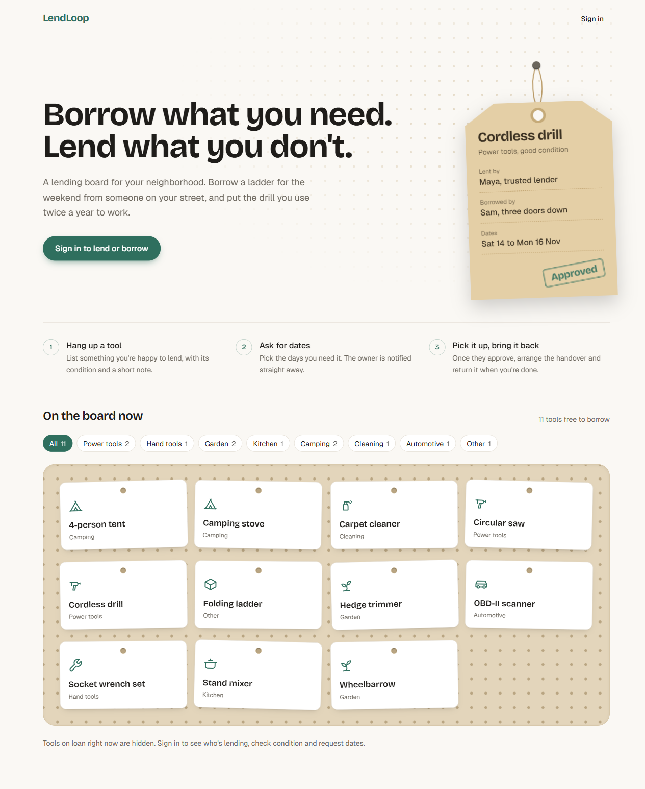
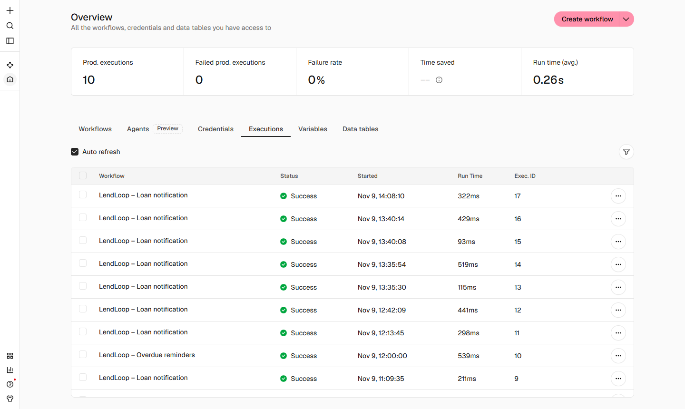
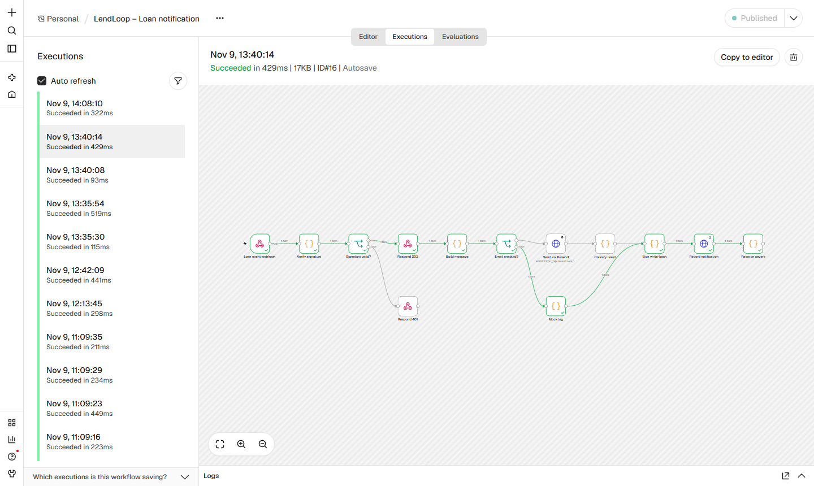
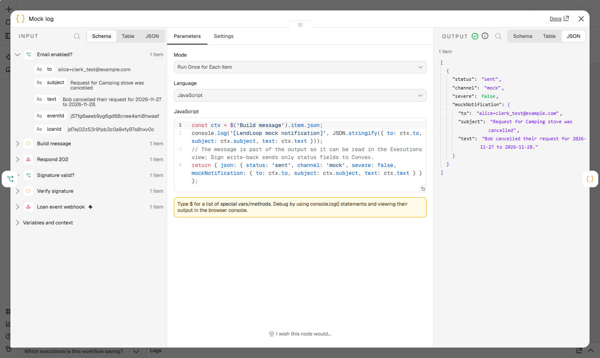

# LendLoop

**Borrow what you need. Lend what you don't.**

LendLoop is a neighborhood tool-lending board. Neighbors list tools they are willing to lend, request to borrow
them for a date range, and the lender approves, declines and marks returns. n8n does the robot work: it emails the
right person whenever a request is created or changes status, and nags borrowers daily about overdue loans. Every
automation step is written back to the loan so it shows up in the app ("Reminder sent 2 days ago").

This is a take-home for Fluence. The assignment text is in [`docs/assignment.md`](docs/assignment.md).




## Live demo

**<https://web-production-594f5.up.railway.app>**

- Sign up with any address of the form `yourname+clerk_test@example.com` and enter the verification code
  **424242** (a Clerk test address; no real email is sent; choose any password if asked). Make two accounts, in two browsers or a private window,
  to play lender and borrower.
- The board is seeded with demo tools and a few loans between two test neighbors, Alice and Bob.
- Notifications run in mock mode: each one is logged by n8n and shows on the loan ("Request mock notification sent").
- n8n: **<https://n8n-production-1175.up.railway.app>**. The login is sent with the submission rather than published
  here, because anyone signed in to n8n can run code on the server and read its secrets. Without a login, the
  screenshots in [Watching the automation in n8n](#watching-the-automation-in-n8n) show the same runs.
- The admin console (`/admin`) needs an admin account. New sign-ups get the normal user role; ask and your account
  will be made an admin from the Users tab.
- Hosting: the Next.js app and n8n (with Postgres) on Railway, the backend on Convex Cloud, auth on a Clerk
  development instance. Details in [Deployment](#deployment).

## Contents

1. [Live demo](#live-demo)
2. [Stack](#stack)
3. [Architecture](#architecture)
4. [Local setup](#local-setup)
5. [Using the app](#using-the-app)
6. [Security and data-minimization decisions](#security-and-data-minimization-decisions)
7. [Reliability and idempotency](#reliability-and-idempotency)
8. [Testing](#testing)
9. [Deployment](#deployment)
10. [Production note](#production-note)
11. [Verification and known limitations](#verification-and-known-limitations)

## Stack

| Layer | Choice |
| --- | --- |
| Frontend | Next.js 16.4 (App Router, TypeScript, Tailwind 4), React 19 |
| Auth | Clerk (`@clerk/nextjs` 7.9.25) |
| Data and backend | Convex 1.49 (queries, mutations, scheduled actions, HTTP actions) |
| Automation | n8n 2.46.6, three workflows in `n8n/workflows/` |
| Email | Resend REST API, called from n8n with an n8n credential; offline mock mode by default |
| Tests | vitest 5 + convex-test |

Node 20+ is required.

## Architecture

```
Browser ──Clerk JWT──▶ Next.js (App Router)
   │                       │  (pages are thin; all data via Convex React hooks)
   └──────Convex client────┴──▶ Convex (queries/mutations/actions, RBAC lives here)
                                  │ outbox + scheduler              ▲ HTTP actions (signed)
                                  ▼                                 │
                        POST /webhook/lendloop-loan-event      GET /n8n/overdue-loans
                                  │                            POST /n8n/notifications
                                  ▼                            POST /n8n/reminders
                                n8n ── Resend ──▶ email        POST /n8n/automation-errors
                                  │  (error workflow on any failure) ─────────┘
```

There are no Next.js API routes. The browser talks to Convex directly with the Clerk JWT, so every authorization
decision is made in Convex functions (`convex/lib/access.ts`), not in the UI. The UI hides only what the backend
already forbids.

The Convex backend has one folder per domain (`users/`, `tools/`, `categories/`, `loans/`, `automation/`, `n8n/`).
In each, `queries.ts`, `mutations.ts` and `actions.ts` are callable from the app, and `internal.ts` holds functions
only the server can call. Shared helpers live in `lib/`, HTTP routes in `http.ts`, and tests sit next to their code.

### Data model (`convex/schema.ts`)

| Table | Purpose |
| --- | --- |
| `users` | Mirror of the Clerk user: `clerkId`, `email`, `name`, `role` (`admin` or `user`), `trustedLender`, `deletedAt` (set when the Clerk account is deleted; the row stays for loan history), `searchText` (lowercased name and email, read by the admin search index) |
| `tools` | Listings: owner, name, category (a category slug), condition, description. Search index on name, filterable by category |
| `categories` | Admin-managed categories: `slug` (stable id stored on tools), `label`, `icon`, `active`, `order`. Seeded with 8 defaults (`categories/internal:seedDefaults`, also run by `npm run seed`); archived ones disappear from new listings and filters but stay on existing tools, and one can only be deleted when no tool uses it |
| `loans` | One borrow request: tool (with a `toolName` snapshot), borrower, lender, `startDate`/`endDate` (`YYYY-MM-DD`), `status` (`pending`, `approved`, `declined`, `returned`, `cancelled`), `lastReminderAt`, `reminderCount` |
| `automationEvents` | Outbox of loan events to deliver to n8n (`pending`, `delivered`, `failed`, attempts, next attempt) |
| `automationLog` | Per-loan timeline shown in the UI, and the idempotency ledger for n8n write-backs (unique by convention on `idempotencyKey`) |

Availability is derived, not stored: a tool is "on loan" exactly when an `approved` loan exists for it, so it cannot
drift.
Removing a tool hard-deletes it; loans keep `toolName`, and pending requests on it are declined with a normal
`loan.declined` event so the borrower hears about it.

### Convex to n8n contract

Both directions use the same signing scheme:

```
x-lendloop-timestamp: <unix ms>
x-lendloop-signature: v1=<hex HMAC-SHA256(secret, `${timestamp}.${rawBody}`)>
x-lendloop-event-id:  <idempotency key>      (Convex -> n8n only)
```

The receiver recomputes the HMAC over the raw bytes, compares in constant time, and rejects timestamps more than
5 minutes from its own clock. Two secrets are used so a leak on one side cannot forge the other direction:
`CONVEX_TO_N8N_SECRET` (Convex signs, n8n verifies) and `N8N_TO_CONVEX_SECRET` (n8n signs, Convex verifies). You
may set both to the same value locally; use different values anywhere real.

| Direction | Endpoint | Purpose | Idempotency key |
| --- | --- | --- | --- |
| Convex to n8n | `POST {n8n}/webhook/lendloop-loan-event` | Deliver a loan event (`loan.requested`, `.approved`, `.declined`, `.returned`, `.cancelled`) | `eventId` (the `automationEvents` id); sent as `x-lendloop-event-id` and reused downstream, n8n itself keeps no state |
| n8n to Convex | `GET {convex-site}/n8n/overdue-loans` | Approved loans with `endDate` before today (UTC) not yet reminded today | Source-side: reminded-today loans are excluded, so a rerun returns nothing new |
| n8n to Convex | `POST /n8n/notifications` | Record that a loan-event notification was sent or failed | `notif:<eventId>` |
| n8n to Convex | `POST /n8n/reminders` | Record an overdue reminder; bumps `reminderCount`/`lastReminderAt` only on the first `sent` | `reminder:<loanId>:<YYYY-MM-DD>` |
| n8n to Convex | `POST /n8n/automation-errors` | Error workflow reports a failed execution | `n8nerr:<executionId>` |

Write-backs answer `{ "ok": true, "created": boolean }`; a replay returns `created: false` and changes nothing.
The Convex routes return `503` if `N8N_TO_CONVEX_SECRET` is not set, `401` on a bad or stale signature, and `400`
on a malformed body.

### Clerk to Convex

`POST {convex-site}/clerk/webhook` keeps the `users` table in step with Clerk. Clerk signs deliveries with Svix
(`svix-id`, `svix-timestamp`, `svix-signature`); `convex/lib/svix.ts` checks the HMAC over `${id}.${timestamp}.${body}`
with `CLERK_WEBHOOK_SECRET` in constant time and rejects timestamps more than 5 minutes off, without the svix library.

| Event | Effect |
| --- | --- |
| `user.created`, `user.updated` | Insert or update the row by Clerk id (name, email, avatar). An `ADMIN_EMAILS` address becomes admin; an update never demotes |
| `user.deleted` | Set `deletedAt`, replace the name with "Deleted user", remove their tools (pending requests are declined with the normal event; approved loans are kept). A replay changes nothing |

Other event types get `200` and are ignored. The route answers `503` without the secret, `401` on a missing, stale or
bad signature, and `400` on a body that is not a JSON object.

Clerk stays the source of truth for names and emails. A name edited in the admin Users tab is saved to Clerk first
(`users/actions:updateName`) and then copied locally. Besides the webhook, the copy is refreshed at every sign-in
and by **Sync with Clerk** in the Users tab (`users/actions:syncFromClerk`), which is how a local setup stays current
since Clerk cannot reach a local backend.

### What happens when a request is approved

1. The lender clicks Approve. The `approve` mutation in `convex/loans/mutations.ts` checks the caller is the loan's lender, the loan is
   still `pending`, and no other approved loan on that tool overlaps the dates.
2. In the same transaction it sets `status: "approved"`, inserts an `automationEvents` row (`loan.approved`,
   recipient = borrower) and schedules `internal.automation.actions.deliverEvent`. If the mutation commits, the event
   exists and a delivery is scheduled.
3. `deliverEvent` builds a minimal payload, signs it with `CONVEX_TO_N8N_SECRET` and POSTs it to
   `N8N_LOAN_EVENT_WEBHOOK_URL`.
4. The n8n **Loan notification** workflow verifies the signature and replies `202` immediately. Convex marks the
   event `delivered` and logs `webhook_delivered`.
5. n8n builds the message and, if `LENDLOOP_EMAIL_ENABLED=true`, sends it through Resend; otherwise (or if Resend
   rejects it) it logs a mock notification.
6. n8n signs a write-back and POSTs `/n8n/notifications` with key `notif:<eventId>`. Convex records
   `notification_sent` or `notification_failed` on the loan timeline, which both neighbors see in the app.

### The three n8n workflows

| Workflow (id) | Trigger | What it does |
| --- | --- | --- |
| Loan notification (`LLLoanNotify0001`) | Webhook, raw body | Verify signature (401 and stop if bad), ack `202`, build message, Resend or mock, sign, POST `/n8n/notifications` |
| Overdue reminders (`LLOverdueRemind1`) | Daily 09:00 UTC | Sign, GET `/n8n/overdue-loans`, fan out one item per loan, Resend or mock, sign, POST `/n8n/reminders`. An empty list is a clean no-op |
| Error handler (`LLErrorHandler01`) | Error Trigger | Summarize the failed execution, sign, POST `/n8n/automation-errors`. Set as `errorWorkflow` on the other two |

More detail, including manual runs and secret rotation, is in [`n8n/README.md`](n8n/README.md).

## Local setup

You need a Clerk account; Convex and Resend accounts are optional.

### Prerequisites

- Node 20+ and npm
- Docker (Docker Desktop on Windows/macOS) with Compose v2
- `openssl` (Git Bash has it) or any way to produce random hex strings
- A free [Clerk](https://clerk.com) account
- Optional: a free [Convex](https://convex.dev) account (see step 3) and a free [Resend](https://resend.com) account

### 1. Install

```bash
git clone <this repo> lendloop && cd lendloop
npm install
cp .env.example .env.local
cp n8n/.env.example n8n/.env
```

### 2. Clerk

1. Create a Clerk application (email sign-in is enough). Leave **Organizations** turned off (Clerk Dashboard,
   Organizations): LendLoop uses personal accounts, and with organizations required every new user is stopped at a
   "choose organization" step after sign-up.
2. Copy the **Publishable key** and **Secret key** (API keys page) into `.env.local` as
   `NEXT_PUBLIC_CLERK_PUBLISHABLE_KEY` and `CLERK_SECRET_KEY`.
3. Let Convex trust Clerk tokens. Either enable the **Convex integration** (Clerk Dashboard, Integrations, Convex)
   or create a **JWT template** named exactly `convex` (Clerk Dashboard, JWT templates, New template, Convex
   preset). The front end requests the `convex` token and `convex/auth.config.ts` expects `applicationID: "convex"`.
   The token must carry the user's `email`. The Convex JWT-template preset does. With the native **Convex
   integration** it does not by default: open Clerk Dashboard, Sessions, **Customize session token** and add
   `{"email": "{{user.primary_email_address}}", "name": "{{user.full_name}}"}`. Without it, sign-in succeeds but
   the app shows "Your account has no email on its Clerk token".
4. Copy the **Issuer** (your Clerk Frontend API URL, for example `https://your-app-12.clerk.accounts.dev`). This is
   `CLERK_JWT_ISSUER_DOMAIN` below.
5. Optional, for the admin **Users** tab: Clerk Dashboard, Webhooks, **Add endpoint** with the URL
   `{convex-site}/clerk/webhook` and the events `user.created`, `user.updated` and `user.deleted`. Copy its
   **Signing secret** (`whsec_...`); it is `CLERK_WEBHOOK_SECRET` below. Clerk cannot reach a Convex backend running
   on your machine, so locally use **Sync with Clerk** in the Users tab instead (it needs only `CLERK_SECRET_KEY`).

### 3. Convex (local deployment)

Generate three random values; you will need them in steps 3 and 4.

```bash
openssl rand -hex 32   # run three times: CONVEX_TO_N8N_SECRET, N8N_TO_CONVEX_SECRET, N8N_ENCRYPTION_KEY
```

Start Convex. On first run it creates the deployment and writes `NEXT_PUBLIC_CONVEX_URL` to `.env.local`.

```bash
npx convex dev
```

When prompted, choose a **local deployment** (the Convex backend runs on your machine; no tunnel needed). Without
a Convex account, run it anonymously instead:

```bash
CONVEX_AGENT_MODE=anonymous npx convex dev      # Git Bash / macOS / Linux
```

Local ports: the client API is `http://127.0.0.1:3210` (`NEXT_PUBLIC_CONVEX_URL`) and the HTTP actions
("site") are at `http://127.0.0.1:3211`. From inside the n8n container the site URL is
`http://host.docker.internal:3211`.

The first push will complain that `CLERK_JWT_ISSUER_DOMAIN` is missing, because `auth.config.ts` needs it. That is
expected: leave `convex dev` running (or restart it) and set the deployment environment in a second terminal.
`npx convex env set` works the same for local and cloud deployments.

```bash
npx convex env set CLERK_JWT_ISSUER_DOMAIN https://your-app-12.clerk.accounts.dev
npx convex env set CONVEX_TO_N8N_SECRET <hex from above>
npx convex env set N8N_TO_CONVEX_SECRET <hex from above>
npx convex env set N8N_LOAN_EVENT_WEBHOOK_URL http://localhost:5678/webhook/lendloop-loan-event
npx convex env set ADMIN_EMAILS you@example.com
npx convex env set APP_URL http://localhost:3000
npx convex env set CLERK_SECRET_KEY <same value as in .env.local>   # admin name edits and Sync with Clerk
npx convex env set CLERK_WEBHOOK_SECRET whsec_...                    # only where Clerk can reach the webhook
```

The local Convex backend runs on your host, so it reaches n8n at `localhost:5678` (the compose file publishes the
port on `127.0.0.1`). Use your n8n's public URL here when Convex runs in the cloud.

### 4. n8n (Docker)

Edit `n8n/.env`: set `N8N_ENCRYPTION_KEY`, `CONVEX_TO_N8N_SECRET` and `N8N_TO_CONVEX_SECRET` (the **same two
values** you gave Convex). The defaults for everything else already point at the local Convex site URL and mock
mode.

```bash
npm run n8n:up
```

Open <http://localhost:5678>. On the first visit n8n asks you to **create the owner account**: use any email and
password you like; it only exists in your local n8n (stored in the Docker volume) and is what you sign in with from
then on. Then:

```bash
npm run n8n:import
```

`n8n:import` imports the three workflows with their stable ids, creates the "Resend API" credential (from
`RESEND_API_KEY`, or a placeholder in mock mode: n8n 2.x hides the data of runs whose credential is missing),
publishes the three workflows (the error handler must be published or n8n refuses to run it) and restarts n8n. Stop the stack with `npm run n8n:down`.

### 5. Seed and run

Keep `convex dev` from step 3 running in terminal 1; the seed command needs the local Convex backend, which only
runs while `convex dev` is up.

```bash
npm run seed       # terminal 2: creates the "LendLoop Demo" neighbor with 8 tools; safe to re-run
npm run dev:next   # terminal 3: Next.js on :3000
```

`npm run dev` (Next.js and `convex dev` together via concurrently) is the single-terminal alternative, only when
`convex dev` is NOT already running.

Open <http://localhost:3000>. The public page lists the seeded tools. Sign up with the email you put in
`ADMIN_EMAILS` to get the admin role, then sign up a second account (another email, private window) to play the
borrower: create a request, approve it from the first account, and watch the timeline fill in.

### Environment variables

Real values are never committed: `.env*` is gitignored except the `*.example` files, and `n8n/.env` is gitignored.

**Next.js: `.env.local`**

| Variable | Required | Meaning |
| --- | --- | --- |
| `NEXT_PUBLIC_CONVEX_URL` | yes | Convex client URL. Written by `convex dev`; `http://127.0.0.1:3210` locally |
| `NEXT_PUBLIC_CLERK_PUBLISHABLE_KEY` | yes | Clerk publishable key |
| `CLERK_SECRET_KEY` | yes | Clerk secret key (server only) |

**Convex deployment env (set with `npx convex env set NAME value`; not read from `.env.local`)**

| Variable | Required | Meaning |
| --- | --- | --- |
| `CLERK_JWT_ISSUER_DOMAIN` | yes | Clerk issuer URL. Must be set before `convex dev` can push the auth config |
| `CONVEX_TO_N8N_SECRET` | yes | HMAC secret Convex uses to sign events to n8n. Must equal n8n's value |
| `N8N_TO_CONVEX_SECRET` | yes | HMAC secret Convex uses to verify n8n's write-backs. Must equal n8n's value. Unset means `/n8n/*` answers 503 |
| `N8N_LOAN_EVENT_WEBHOOK_URL` | yes | Where Convex POSTs events, ending in `/webhook/lendloop-loan-event`. Unset means events fail terminally with a visible error |
| `ADMIN_EMAILS` | for an admin | Comma-separated emails that become `admin`. Checked on every `ensure` (`convex/users/mutations.ts`) |
| `APP_URL` | no | Base URL used for the links in notifications. Defaults to `http://localhost:3000` |
| `CLERK_SECRET_KEY` | for the Users tab | Same key as in `.env.local`. Lets admins edit names and run **Sync with Clerk** through the Clerk Backend API (`convex/users/actions.ts`). Unset means those two actions say "isn't configured" |
| `CLERK_WEBHOOK_SECRET` | for the webhook | Signing secret of the Clerk webhook endpoint (`whsec_...`). Unset means `/clerk/webhook` answers 503 |

**n8n: `n8n/.env`**

| Variable | Required | Meaning |
| --- | --- | --- |
| `N8N_ENCRYPTION_KEY` | yes | Encrypts credentials in n8n's database. Do not change after first start |
| `CONVEX_TO_N8N_SECRET` | yes | Verifies Convex's signatures. Same as the Convex value |
| `N8N_TO_CONVEX_SECRET` | yes | Signs write-backs. Same as the Convex value |
| `LENDLOOP_CONVEX_SITE_URL` | yes | Convex HTTP actions base URL. Local default `http://host.docker.internal:3211`; cloud `https://<name>.convex.site` |
| `LENDLOOP_EMAIL_ENABLED` | no | `false` (default) is fully offline mock mode; `true` sends via Resend |
| `LENDLOOP_EMAIL_FROM` | no | From address. Default `LendLoop <onboarding@resend.dev>` |
| `RESEND_API_KEY` | no | Import-time only. `npm run n8n:import` stores it as the encrypted n8n credential "Resend API". It is not passed to the container |
| `N8N_PUBLIC_URL` | no | Public URL of n8n, used as `WEBHOOK_URL`. Default `http://localhost:5678` |

### Turning on real email (optional)

1. Create a Resend API key. Without a verified domain Resend only delivers to the account owner's address, so
   use that address for the neighbor who receives mail.
2. In `n8n/.env` set `RESEND_API_KEY` and `LENDLOOP_EMAIL_ENABLED=true`.
3. `npm run n8n:up` (recreates the container with the new flag), then `npm run n8n:import` (creates the
   credential).

A 4xx from Resend (for example an unverified recipient) does not break anything: it is recorded on the loan as
`notification_failed` and the message is mock-logged instead.

## Using the app

| Route | Who | What |
| --- | --- | --- |
| `/` | public | Tagline, read-only list of available tools (name and category), "Sign in to lend or borrow" |
| `/browse` | signed in | All tools with availability, owner first name, trusted badge; category filter; request dialog with date range |
| `/listings`, `/listings/new`, `/listings/[id]/edit` | signed in | My listings: create, edit, delete |
| `/requests` | signed in | My outgoing requests, cancel, automation timeline per loan |
| `/incoming` | signed in | Requests on my tools: approve, decline, mark returned, timeline |
| `/admin` | admin | All loans, all listings (remove), users (search, Trusted Lender, admin role, edit name, sync with Clerk), categories, automation failures |
| `/sign-in`, `/sign-up` | public | Clerk components |

**Roles.** A `user` can create, edit and delete only their own listings and act only on requests for their own
tools or their own borrowing. An `admin` can also see every loan, remove any listing, mark Trusted lenders, manage
categories, make or remove admins and correct names, but cannot approve, decline or return other people's loans.

The first admin comes from the `ADMIN_EMAILS` Convex env var (comma separated): a matching email gets the admin role
at sign-in. After that, admins can make others admin in the **Users** tab (`users/mutations:setRole`). Removing the
role is refused for yourself, for `ADMIN_EMAILS` admins (they would get it back at their next sign-in) and for the
last admin; the demo account cannot be made admin, and deleted accounts cannot be changed. Taking an email out of
`ADMIN_EMAILS` does not remove that person's admin role.

**Rules worth knowing.** Dates are ISO `YYYY-MM-DD`, the start must not be in the past (UTC) or after the end, and
there is no limit on how long a loan can be (the borrower asks for the days they need; the lender decides). You cannot borrow your own tool. A request for days that overlap an already
**approved** loan is rejected (`request` in `convex/loans/mutations.ts`), and approval checks again (`approve`). Overlapping **pending**
requests are allowed (the lender chooses). Dates are picked on a calendar that crosses out booked days
(`bookedRanges` in `convex/loans/queries.ts` returns only the start and end dates of approved loans, never who borrowed), so a tool that is
on loan can still be requested for free days. A borrower can cancel while pending, or while approved but not yet
started.

**Demo seed caveat.** `npm run seed` creates a synthetic neighbor "LendLoop Demo" (`clerkId: "seed:demo"`) with
eight tools so the board is not empty. Nobody can sign in as it, so requests to those tools stay pending forever.
To see the full approve-and-return flow, list a tool with one account and request it from another.

### Watching the automation in n8n

Sign in at <http://localhost:5678> with the owner account you created during setup, or use the live demo's n8n (see
[Live demo](#live-demo)). The screenshots below are from the live demo.

- **Every run:** sidebar **Overview**, tab **Executions** (or open a workflow and use its own **Executions** tab).
  Green runs succeeded, red ones failed. Each borrow request, approval, decline, return or cancellation in the app
  produces one "LendLoop – Loan notification" run within a second or two.

  
- **Read a mock notification:** click a run, then the **Mock log** node. Its output has
  `mockNotification` with `to`, `subject` and `text`, for example
  `{ "to": "alice+clerk_test@example.com", "subject": "Request for Camping stove was cancelled", "text": "Bob cancelled their request for 2026-11-27 to 2026-11-28." }`.
  With real email on, look at **Send via Resend** and the Resend dashboard instead.

  

  
- **Follow one run end to end:** **Verify signature** (was the call from Convex genuine), **Build message** (who is
  told what), **Mock log** or **Send via Resend**, **Sign write-back** and **Record notification** (Convex's reply;
  `created: false` means a retry was recognised as a duplicate).
- **Reminders:** open "LendLoop – Overdue reminders" and click **Execute workflow** to run it now instead of waiting for
  09:00 UTC. With no overdue loans it ends early; re-running on the same day sends nothing new.
- **Failures:** failed runs are red here, the "LendLoop – Error handler" workflow has its own executions, and the same
  failures show in the app's admin console under **Automation failures**.
- **In the app:** each loan card shows the outcome in plain words ("Bob was notified about your request"); the admin
  console's **Last activity** column shows the technical step.

Container logs (`docker compose logs n8n`, Railway logs) only show startup and errors, not the notifications.

### Lists and search

- Long lists are split into pages with Previous / Next. Browse searches tool names (a Convex search index) together
  with the category filter.
- Incoming has tabs for Needs your decision, Active loans and History. The admin console has tabs for Loans,
  Listings, Users, Categories and Automation failures; the open tab is kept in the URL, so it survives a refresh.

## Security and data-minimization decisions

**The server decides who you are.** The browser never says who the user is or what role they have. Each Convex
function reads the signed-in user from the Clerk token (`requireUser` and `requireAdmin` in `convex/lib/access.ts`)
and then checks they own the tool or loan before changing it. Admin actions do take the id of the user being
changed (for example `setRole` or `setTrustedLender`), but the caller still has to be an admin. Only three functions
work signed out: the public tool list, the category list and `users:me` (which returns nothing). Why: anything sent
from the browser can be faked.

**The public page shows only what it needs.** `listPublic` (`convex/tools/queries.ts`) returns each tool's name and
category, and skips tools that are on loan. Owner, condition and description are never sent to signed-out visitors.
Why: the assignment asks for no owner details there, and leaving fields out on the server is safer than hiding
them in the page.

**n8n gets only what it needs to send a message.** For a loan event that is the recipient's email, both first names,
the tool name, the dates, the status and a link. For an overdue loan it is the borrower's first name and email, the
lender's first name, the tool, the dates and the days overdue. No user ids, no other email addresses, no tool
descriptions. Error messages coming back from n8n have email addresses replaced with `[email]` before they are
stored (`convex/n8n/internal.ts`). Why: n8n keeps a history of every run, so everything it receives is stored there.

**Messages between Convex and n8n are signed.** Each request carries a timestamp and an HMAC signature made with a
shared secret, and the receiver rejects it if the signature does not match or the timestamp is more than 5 minutes
old. Each direction has its own secret. Why: this stops anyone else from sending fake events or fake results, or
replaying an old request, and a leaked secret only opens one direction.

**Bad requests do not trigger alarms.** An unsigned or expired request to the n8n webhook gets `401` and stops
there, without starting the error workflow. Why: otherwise anyone who finds the URL could fill the admin console
with fake failures.

**Secrets are never in the repo.** They live in environment variables: `.env.local` for Next.js, the Convex
environment for Convex, and `n8n/.env` locally or Railway variables on the live demo for n8n. The Resend key is
stored encrypted inside n8n. Only the `.env.example` files are committed, with names and no values, and a test
(`n8n/workflows.test.ts`) fails if the exported workflows contain anything that looks like a secret. One caveat:
the workflows read their secrets from the environment, so anyone who can log in to the n8n editor can read them.
That is why the live n8n login is not published.

**Admins have limited powers.** They cannot approve, decline or return other people's loans, and nobody can remove
the last admin or their own admin role, so the app cannot lock itself out. The full list is under
[Roles](#using-the-app).

**The Clerk webhook only accepts messages from Clerk.** `/clerk/webhook` checks Clerk's signature and rejects
anything older than 5 minutes (`convex/lib/svix.ts`). The Clerk secret key stays in the Convex environment, and if a
call to Clerk fails, only the status code is shown, not Clerk's reply. Why: this webhook can create and delete user
records, and Clerk's replies can contain account details.

**The n8n container is locked down where it runs locally.** `n8n/docker-compose.yml` binds n8n to `127.0.0.1` only,
turns off telemetry, enforces settings-file permissions and runs Code nodes in task runners. `N8N_SECURE_COOKIE=false`
is set only because local n8n runs over plain HTTP. The live n8n on Railway uses HTTPS but its editor is reachable
from the internet, protected only by n8n's own login; for real use it should sit behind a VPN or SSO.

**Input is checked on the server.** Tool names 2 to 60 characters, descriptions up to 300, category names 2 to 30,
user names up to 50, and dates must be real calendar days with the start not in the past and not after the end
(`convex/lib/validation.ts`, `convex/users/actions.ts`, unit-tested). Why: limits in the browser are easy to skip.

## Reliability and idempotency

**Convex to n8n (outbox).** A loan status change, its `automationEvents` row and the scheduled `deliverEvent` commit
in one transaction, so every committed change gets a delivery attempt. A non-2xx or network error reschedules it
after 30 s, 2 min, 10 min and 30 min; after the 5th failure the event is `failed` and a `webhook_failed` row shows on
the loan and in the admin console. Status guards stop a late or duplicate run from repeating a transition.

**n8n side.** The webhook answers `202` right after checking the signature, so Convex retries only when n8n did not
accept the event (including a `401`). HTTP Request nodes (Resend and the write-backs to Convex) retry 3 times,
2 seconds apart, and each outcome is recorded:

| Resend result | Recorded on the loan | Error workflow |
| --- | --- | --- |
| 2xx | `notification_sent` (channel `email`) | no |
| 4xx (e.g. unverified recipient) | `notification_failed`, message mock-logged (channel `mock`) | no, it is a business outcome |
| 5xx or 429 | `notification_failed` row is written first | yes, a "Raise on severe" node then throws |
| Network error or write-back failure after retries | nothing (the write-back is what failed) | yes |

The error workflow posts to `/n8n/automation-errors`, so failed runs also show in the admin console as
`workflow_error`. The mock path has run against the live n8n; the Resend rows have not (see
[Verification and known limitations](#verification-and-known-limitations)).

**Retries never duplicate.** Every write-back goes through the `automationLog` idempotency ledger, keyed as in the
[contract table](#convex-to-n8n-contract): a replay returns `created: false` and changes nothing, and the reminder
counter moves only on the first `sent`. `GET /n8n/overdue-loans` skips loans already reminded today, so re-running
the schedule sends nothing new. Emails carry the same key in Resend's `Idempotency-Key` header (honored for
24 hours). n8n keeps no state, so in mock mode a redelivered event can be logged twice, which is harmless.

**Known gap.** Convex runs a scheduled action at most once. If `deliverEvent` dies mid-run, its event stays `pending`
with no log row. A cron that re-queues events whose `nextAttemptAt` is long past would close this.

## Testing

```bash
npm test          # 169 vitest tests
npm run lint
npm run typecheck
npm run build
```

`npm test` covers:

- **RBAC** (convex-test): non-lender cannot approve, decline or return; non-owner cannot edit or delete; non-admin
  cannot remove others' listings or list all loans; admin cannot act on others' loans; the public query shape;
  admin bootstrap via `ADMIN_EMAILS`.
- **Validation**: names, descriptions, dates, ranges, overlap.
- **Outbox**: events created on each status change, backoff, terminal failure, orphaned events, status guards.
- **HTTP routes**: signature required, 503 without a secret, 400 on malformed bodies, a double POST creates one
  log row and one reminder bump.
- **Signature**: sign/verify, replay window, tampering.
- **Users admin** (`convex/users/admin.test.ts`): `setRole` guards (non-admin, self-demotion, `ADMIN_EMAILS`
  admins, last admin, deleted and demo accounts), user search and role filter, the `searchText` backfill, the Clerk
  webhook (503/401/400, create/update upsert, never demoting, delete removing tools and declining pending requests,
  replays) and the Clerk actions against a mocked Clerk API (name edit, paged sync, errors, non-admin callers).
- **Svix** (`convex/lib/svix.test.ts`): a known test vector, an independent WebCrypto signature, several signatures
  in one header, tampering, wrong secret or version, and missing or stale timestamps.
- **n8n workflows** (`n8n/workflows.test.ts`): workflow structure, connections, error-workflow wiring, no secrets
  in the JSON, and contract tests that run the Code nodes' logic against the signature scheme.

## Deployment

The live demo runs like this:

| Piece | Where | Notes |
| --- | --- | --- |
| Next.js app | Railway service built from this repo (Railpack) | `NEXT_PUBLIC_CONVEX_URL`, `NEXT_PUBLIC_CLERK_PUBLISHABLE_KEY`, `CLERK_SECRET_KEY`; Next binds Railway's `PORT` |
| n8n | Railway service built from [`n8n/railway/Dockerfile`](n8n/railway/Dockerfile) (`RAILWAY_DOCKERFILE_PATH`) | Pinned n8n 2.46.6 with the workflows baked in; imports and publishes them on boot. Step by step in [`n8n/railway/README.md`](n8n/railway/README.md) |
| n8n database | Railway Postgres | Referenced with `${{Postgres.PGHOST}}` etc. |
| Backend | Convex Cloud production deployment (`npx convex deploy`) | Env vars as listed above, with the Railway n8n webhook URL in `N8N_LOAN_EVENT_WEBHOOK_URL`, the Railway app URL in `APP_URL`, and `CLERK_SECRET_KEY` plus `CLERK_WEBHOOK_SECRET` for the Users tab |
| Auth | Clerk development instance | Fine for a demo; real use needs a Clerk production instance with its own keys. A webhook endpoint posts `user.created`, `user.updated` and `user.deleted` to `https://<prod>.convex.site/clerk/webhook` |

Production uses its own signing secrets and n8n encryption key, different from the local ones. Nothing secret is in
the repo: Railway and Convex hold them as environment variables. The n8n owner account was created right after the
first deploy so the internet-facing editor could not be claimed by someone else.

## Production note

The live demo is fine for a review, not for real neighbors. What I would change, most important first:

1. **Real email.** Verify a sending domain in Resend (SPF/DKIM) so mail reaches every neighbor, not only the account
   owner, and add notification preferences and unsubscribe before sending reminders to real people.
2. **Email alerts on failures.** Today a failed delivery or n8n run is only logged (`webhook_failed`,
   `workflow_error`) and seen by someone who opens `/admin`. Email the admins instead: a Resend node in the error
   workflow for n8n failures, and the same for events the Convex outbox gives up on.
3. **Rate limits.** Limit the public tool list and request creation per user or IP, and cap open requests per
   borrower. The signed routes (`/n8n/*`, `/clerk/webhook`, the n8n webhook) reject forgeries cheaply but still
   accept unlimited traffic.
4. **Audit log.** Record who removed a listing, changed Trusted lender, granted or removed admin, or edited a name.
   None of these leave a trace today.
5. **Dates in the user's time zone.** "Today", overdue and the 09:00 reminder are UTC, so near midnight a user can
   be told a start date is in the past, and reminders arrive at odd local hours.
6. **CI/CD.** There is no pipeline yet. Run `npm test`, `lint`, `typecheck` and `build` on every push, deploy Convex
   and both Railway services from that pipeline, and check that `n8n/workflows/` matches what n8n is running.

## Verification and known limitations

The automated checks are in [Testing](#testing).

**Checked by hand (2026-11-08 and 09):**

- Locally, with n8n in Docker and the local Convex backend: each loan change sends a notification through n8n and
  back; while n8n is down events wait and are delivered once it returns; a bad signature gets `401`; a broken run
  shows up under **Automation failures**; overdue reminders go out once per day.
- In a browser with real Clerk sign-in: listing, requesting, approving, declining, cancelling and returning, the
  admin console, a phone-width screen and dark mode.
- On the live demo: a full borrow loop delivered every notification through n8n on Railway, and Users tab changes
  sync with Clerk in both directions.

**Known limitations:**

- No real email has been sent through Resend; the demo runs in mock mode. Without a verified domain, Resend would
  only deliver to the account owner.
- The seeded demo tools belong to an account nobody can sign in as, so requests for them stay pending.
- Dates and the 09:00 reminder use UTC.
